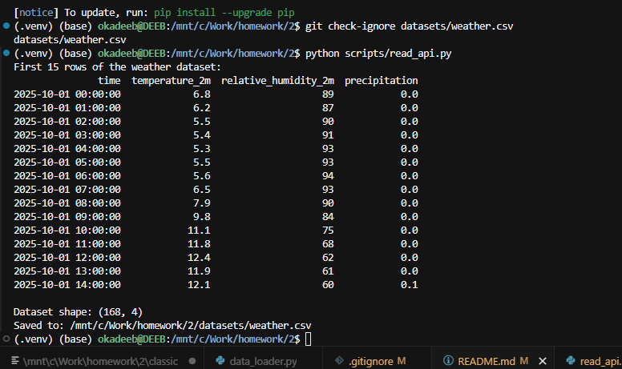

# Homework 4 — Weather API

This script collects historical hourly weather data for Berlin from the [Open-Meteo API](https://open-meteo.com/en/docs/historical-weather-api).

The dataset contains temperature, humidity, and precipitation measurements from October 1–7, 2025.

## Run

From the project root:

```bash
python scripts/read_api.py
```

The dataset is saved locally to `datasets/weather.csv` and excluded from Git.

## Dataset Preview

